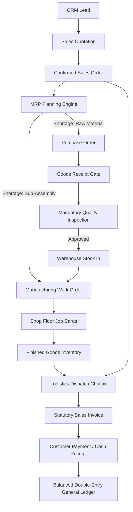
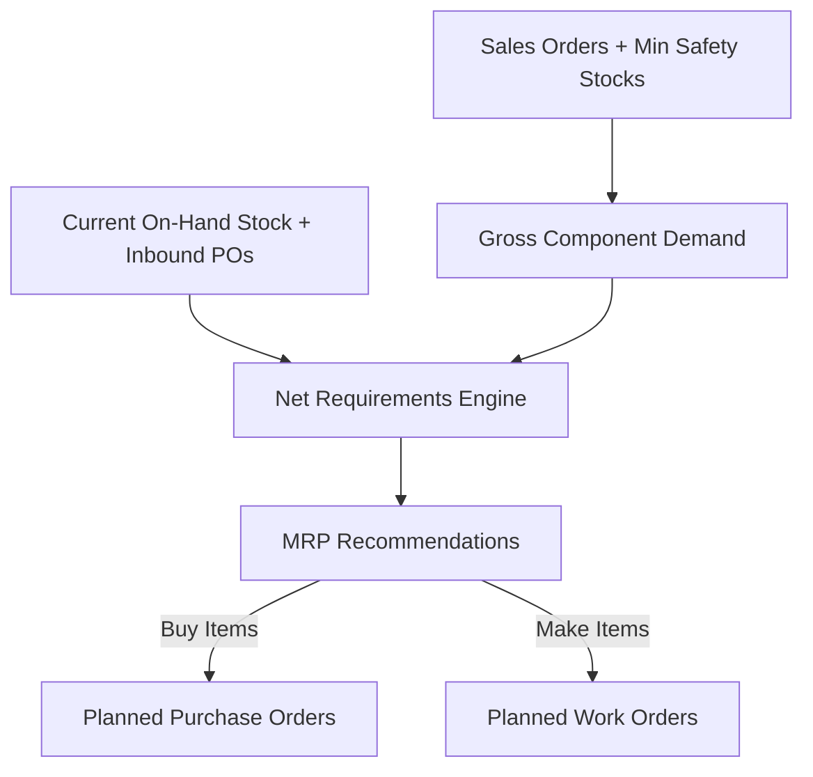

# Spindl ERP — Complete Client User Manual & Operating Guide

> **Welcome to Spindl ERP** — the modern, high-precision Enterprise Resource Planning and Manufacturing Execution System built specifically for businesses that make, assemble, and distribute physical products.
> 
> Spindl combines high-velocity productivity aesthetics (inspired by Linear) with strict double-entry financial invariants, real-time multi-warehouse inventory tracking, and closed-loop manufacturing execution.

---

## Table of Contents

1. [System Overview & Operating Philosophy](#1-system-overview--operating-philosophy)
2. [User Roles, Permissions & Security](#2-user-roles-permissions--security)
3. [Global Navigation, Controls & Shortcuts](#3-global-navigation-controls--shortcuts)
4. [End-to-End Operational Lifecycle](#4-end-to-end-operational-lifecycle)
5. [Workspace Overview & Real-Time Dashboard](#5-workspace-overview--real-time-dashboard)
6. [Sales & Commercial Operations](#6-sales--commercial-operations)
7. [Point of Sale (POS) Cashier Terminal](#7-point-of-sale-pos-cashier-terminal)
8. [Purchasing, Procurement & Requisitions](#8-purchasing-procurement--requisitions)
9. [Production Execution (MES & Shop Floor)](#9-production-execution-mes--shop-floor)
10. [Planning Engine (MRP — Material Requirements Planning)](#10-planning-engine-mrp--material-requirements-planning)
11. [Engineering Change Orders (ECO & Revision Control)](#11-engineering-change-orders-eco--revision-control)
12. [Quality Assurance & ISO Gates](#12-quality-assurance--iso-gates)
13. [Maintenance Management (CMMS & Tooling)](#13-maintenance-management-cmms--tooling)
14. [Workforce & Skills Matrix](#14-workforce--skills-matrix)
15. [Logistics, Dispatch Challans & Transport](#15-logistics-dispatch-challans--transport)
16. [General Ledger & Financial Accounting](#16-general-ledger--financial-accounting)
17. [Inventory Management & Multi-Warehouse Control](#17-inventory-management--multi-warehouse-control)
18. [Customer Directory & CRM Leads Studio](#18-customer-directory--crm-leads-studio)
19. [Product Master Catalog & Bills of Materials](#19-product-master-catalog--bills-of-materials)
20. [Data Imports, Exports & Migrations](#20-data-imports-exports--migrations)
21. [Team Administration, Security & Audit Explorer](#21-team-administration-security--audit-explorer)
22. [Client Day-1 Go-Live Checklist](#22-client-day-1-go-live-checklist)

---

## 1. System Overview & Operating Philosophy

Spindl ERP was engineered to eliminate the clunky, slow, bloated interfaces of legacy enterprise systems. It provides a crisp, quiet, distraction-free environment that prioritizes speed, clarity, and mathematical accuracy.

### Core Architectural Invariants

* **Strict Double-Entry General Ledger:** Every economic event—whether a sale, purchase invoice, POS checkout, scrap adjustment, or vendor payment—posts balanced debits and credits in real time. Debits must strictly equal credits.
* **Perpetual Inventory Valuation:** Stock balances are updated automatically upon goods receipt, job dispatch, transfer, or sale. You never have to guess physical stock vs. book stock.
* **Closed-Loop Manufacturing:** Engineering revisions (ECOs) feed directly into Bills of Materials (BOM), which drive MRP planning, trigger purchase requisitions, generate shop-floor work orders, and enforce quality gate dispositions before delivery.
* **Tamper-Evident Audit Trail:** Every sensitive state change, approval, deletion, and role adjustment is logged immutably in the central Audit Explorer with user timestamps and IP signatures.

---

## 2. User Roles, Permissions & Security

Spindl utilizes strict Role-Based Access Control (RBAC). When onboarding team members, assign the lowest privilege required for their daily function:

| Role | Intended Users | Permissions & Boundary Limits |
|---|---|---|
| **OWNER** | Company Founders, Managing Directors | Unrestricted access across all financial, operational, and administrative settings. Exclusive authority to delete tenants or transfer ownership. |
| **ADMIN** | Operations Directors, Controllers, IT Leads | Full access to create/edit records, manage team members, configure system preferences, adjust chart of accounts, and approve high-value transactions. |
| **MANAGER** | Production Supervisors, Procurement Heads, Sales Leads | Departmental authority to approve purchase orders, authorize dispatch challans, schedule shifts, sign off on ECOs, and trigger MRP engine runs. |
| **OPERATOR** | Shop Floor Machinists, Cashiers, Warehouse Clerks | Execution-level access: logging job card outputs, barcode scanning at POS, staging goods receipts, and picking stock. Cannot delete records or view executive financials. |
| **VIEWER** | External Auditors, Investors, Trainees | Read-only access to authorized reports, catalogs, and registers. Zero mutation capability. |

---

## 3. Global Navigation, Controls & Shortcuts

The application interface is divided into three consistent structural zones:

```
┌────────────────────────────────────────────────────────────────────────┐
│ TOPBAR: [Breadcrumbs]          [API Connection] [Notifications] [User] │
├───────────────┬────────────────────────────────────────────────────────┤
│ SIDEBAR (220) │ MAIN WORKSPACE AREA                                    │
│ - Search ⌘K   │ - Metric KPI Cards                                     │
│ - WORKSPACE   │ - Sub-Navigation Tabs                                  │
│   • Overview  │ - High-Density Filter Toolbar                          │
│   • Sales     │ - Unified Data Table / Interactive Drawers             │
│   • POS       │                                                        │
│ - MANAGE      │                                                        │
│ - PREFERENCES │                                                        │
└───────────────┴────────────────────────────────────────────────────────┘
```

### Productivity Shortcuts

* <kbd>Cmd</kbd> + <kbd>K</kbd> / <kbd>Ctrl</kbd> + <kbd>K</kbd> : Global Command Palette & Quick Search. Instantly navigate to any customer, SKU, work order, or module.
* <kbd>/</kbd> : Instant table filter focus. Type any fragment of a reference number, supplier name, or item code.
* <kbd>Esc</kbd> : Dismiss active inspection drawer, modal window, or barcode prompt.
* <kbd>Enter</kbd> (in POS Search) : Instant barcode scanner line-item addition.

---

## 4. End-to-End Operational Lifecycle

The diagram below illustrates how data and materials flow through Spindl from lead acquisition to final financial settlement:



---

## 5. Workspace Overview & Real-Time Dashboard

The **Overview** module is your operational cockpit. It aggregates live metrics from all operational departments into actionable intelligence.

```
┌───────────────────────────────────────────────────────────────────────────────────────────┐
│ [₹ 27,750.00]       [₹ 15,900.00]      [₹ 1,16,500.00]     [₹ 15.20L]        [2 Open]     │
│ Sales This Month    A/R Outstanding    A/P Payables        Inventory Value   Orders       │
└───────────────────────────────────────────────────────────────────────────────────────────┘
```

### Key Capabilities

1. **Executive KPI Strip:**
   * **Sales This Month:** Total recognized revenue from posted sales invoices.
   * **Accounts Receivable (A/R):** Total unpaid customer invoices past due date.
   * **Accounts Payable (A/P):** Total outstanding liabilities to vendors.
   * **Inventory Valuation:** Total cost basis of on-hand items across all active warehouses.
2. **Business Cashflow & Billing Trends:**
   * Toggle between `30D`, `90D`, `6M`, and `1Y` periods to visualize invoiced sales versus supplier bills and track net cash trajectory.
3. **Needs Attention Triage Deck:**
   * Displays immediate operational bottlenecks (e.g., *Overdue supplier payables*, *Low inventory thresholds*, *Orders awaiting shipment*, or *ISO metrology calibration alerts*).
   * Clicking **Review**, **Pay bills**, or **Dispatch** navigates directly to the relevant document.
4. **Recent Transactions Register:**
   * Scannable live feed of customer invoices, vendor bills, credits, and cash receipts. Filter with one click between `All`, `Sales Invoices`, `Supplier Bills`, and `Payments`.

---

## 6. Sales & Commercial Operations

The **Sales** module governs customer quotations, sales orders, pick-pack-dispatch workflows, statutory tax invoicing, and credit notes.

```
Quotation ──► Sales Order ──► Dispatch Challan ──► Sales Invoice ──► Payment Receipt
```

### Step-by-Step Workflows

#### A. Creating Quotations & Converting to Orders
1. Navigate to **Workspace → Sales → Quotations** and click **+ New Quotation**.
2. Select the customer from the dropdown. Customer payment terms and tax numbers are auto-populated.
3. Add item lines, specifying quantities and unit prices. The system automatically computes CGST, SGST, IGST, or VAT rates.
4. Once the customer confirms, click **Convert to Order**. This creates a formal binding **Sales Order**, locks in pricing, and triggers demand flags in the MRP Planning engine.

#### B. Dispatch & Warehouse Fulfillment
1. When goods are ready for delivery, select the order and click **Dispatch**.
2. Specify the dispatched quantities per SKU and assign the dispatching warehouse.
3. Upon confirmation, Spindl immediately creates a **Dispatch Challan** and deducts physical inventory from the specified storage location.

#### C. Invoicing & Payment Collection
1. Click **Invoice Order** from the Sales Order view.
2. The system generates an immutable statutory invoice with legal snapshot numbering (e.g., `INV-2026-0089`).
3. When customer payment arrives, click **Record Payment**, choose the ledger account (`Bank Transfer`, `RTGS`, `Cash`, `UPI`), input the transaction reference, and submit. Accounts Receivable is automatically cleared.

> [!TIP]
> If a customer returns damaged or excess goods, open the invoice and click **Return / Credit Note**. This issues an official credit voucher and updates both the inventory ledger and customer balance.

---

## 7. Point of Sale (POS) Cashier Terminal

The **POS** module is optimized for lightning-fast over-the-counter retail checkout, trade counter sales, and parts counter dispensing.

```
┌────────────────────────────────────────────────────────────────────────────────────────┐
│ [Scan barcode / search item...]                          │ CURRENT BASKET (3 items)    │
│ ┌─────────────────┐ ┌─────────────────┐ ┌──────────────┐ │ Customer: Walk-In Cash      │
│ │ HEX-BOLT-M12    │ │ BALL-BEARING-62 │ │ CALIB-SVC    │ ├─────────────────────────────┤
│ │ High Tensile    │ │ 25x52x15mm      │ │ ISO Service  │ │ Subtotal:        ₹ 4,350.00 │
│ │ ₹ 48.50  [+Add] │ │ ₹ 380.00  [+Add]│ │ ₹ 8,500 [+Add│ │ Tax (GST 18%):     ₹ 783.00 │
│ └─────────────────┘ └─────────────────┘ └──────────────┘ │ Total Due:       ₹ 5,133.00 │
│                                                          │ [ CASH ] [ CARD ] [  UPI  ] │
└────────────────────────────────────────────────────────────────────────────────────────┘
```

### Daily Cashier Procedure

1. **Shift Opening:**
   * At the start of a register shift, enter the **Opening Float** (initial cash in drawer, e.g., `₹ 500.00`).
2. **Item Scanning & Basket Building:**
   * Focus the search bar (<kbd>/</kbd>) and scan barcodes directly with an optical scanner or type part of a SKU.
   * Tap or click any product card to increment quantity in the cart.
   * Filter rapidly using category pills: `Fasteners`, `Bearings`, `Raw Materials`, `Services`.
3. **Customer Attribution:**
   * Defaults to `Walk-in Customer (Unregistered)`.
   * For trade account customers, select their name from the dropdown to automatically apply corporate discounts or credit terms.
4. **Checkout & Tender Selection:**
   * Select payment mode: **Cash**, **Card**, **UPI**, or **Other**.
   * For cash transactions, enter the tendered amount; the terminal instantly calculates the exact return change.
5. **Receipt & Ledger Posting:**
   * Clicking **Post Sale** immutably writes the double-entry sale record, prints a compact thermal receipt, and deducts sold quantities from the register's warehouse inventory.
6. **Shift Closing & Drawer Reconciliation:**
   * Click **Close Shift** to view calculated expected cash versus physical count. Discrepancies are logged for manager audit.

---

## 8. Purchasing, Procurement & Requisitions

The **Purchases** module handles the complete procure-to-pay lifecycle, ensuring you never run out of raw materials while maintaining strict three-way matching against bills.

### Key Workflows

```
Requisition ──► Purchase Order ──► Goods Receipt ──► Supplier Bill ──► Disbursement
```

1. **Internal Requisitions:** Shop floor operators submit material requests. Department heads review and click **Convert to PO** with one click.
2. **Automated Reorder Suggestions:** Spindl continuously monitors item reorder trigger levels. If stock falls below buffer minimums, the system generates pre-calculated purchase suggestions.
3. **Purchase Orders (PO):**
   * Draft POs are sent to vendors via PDF/Email.
   * Multi-currency and tax rates are locked upon manager approval.
4. **Goods Receipt Note (GRN):**
   * When shipments arrive at the dock, warehouse clerks click **Receive**.
   * Partial shipments are supported (e.g., receive 50 of 100 bolts).
   * Received items automatically enter **Quality Quarantine** if inspection is mandatory.
5. **Supplier Bills & 3-Way Matching:**
   * Record the vendor's tax invoice number and verify line items against the actual received quantities.
   * Prevents over-billing or paying for unreceived goods.
6. **Disbursements:**
   * Issue check, wire, or bank payment against the open bill.

---

## 9. Production Execution (MES & Shop Floor)

The **Production** module manages work orders, multi-level bills of materials, routing sequences, and shop-floor job card execution.

```
┌───────────────────────────────────────────────────────────────────────────────────────────┐
│ WORK ORDER: WO-20261118-01 — CNC Rotor Sub-Assembly                                       │
│ Destination: Main Finished Assembly Warehouse · Priority: HIGH                           │
├───────────────────────────────────────────────────────────────────────────────────────────┤
│ Required Components:                                                                      │
│ • TITANIUM-ROD-025 (50 kg required / 50 issued) ──────────────────── [100% Complete]      │
│ • HEX-BOLT-M12 (20 pcs required / 20 issued) ─────────────────────── [100% Complete]      │
├───────────────────────────────────────────────────────────────────────────────────────────┤
│ Routing Operations:                                                                       │
│ 10: CNC Rough Turning ──► 20: 5-Axis Milling ──► 30: Ultrasonic Degrease ──► 40: Quality │
└───────────────────────────────────────────────────────────────────────────────────────────┘
```

### Production Workflows

1. **Bill of Materials (BOM) Setup:**
   * Define finished goods and sub-assemblies.
   * Specify child component SKUs, required quantities per unit, scrap allowances (e.g., `2.5%`), and active revision numbers (`Rev A`, `Rev B`).
2. **Work Center Configuration:**
   * Define machine stations, labor rates per hour, overhead rates, and operational capabilities.
3. **Work Order Execution:**
   * Click **New Work Order**, pick finished SKU, quantity, and target warehouse.
   * The system automatically reserves raw material stock.
   * Click **Issue Materials** to transfer inventory from raw staging to active Work-In-Progress (WIP).
4. **Job Cards:**
   * Operators log machine time, good units produced, and scrap units per routing step.
   * When the final operation completes, the finished product is automatically stocked in the target warehouse.

---

## 10. Planning Engine (MRP — Material Requirements Planning)

The **MRP Planning** engine analyzes unfulfilled customer sales orders, minimum safety buffers, and active work orders to calculate exact net shortages across all levels of your supply chain.



### How to Run & Triage MRP

1. Navigate to **Workspace → Planning (MRP)**.
2. Click **Run MRP Engine**.
3. Select the **Planning Horizon** (e.g., `8 Weeks` or `12 Weeks`) and decide whether to include statutory safety buffers.
4. Click **Execute Calculation**. In seconds, Spindl explodes all multi-level BOMs, compares requirements against inventory ledgers, and generates a prioritized recommendation list.
5. **Urgency Triage:**
   * **CRITICAL:** Immediate shortage. Production line stoppage or late customer shipment if not ordered today.
   * **HIGH:** Order release required within 48 hours to accommodate supplier lead time.
   * **MEDIUM / NORMAL:** Planned buffer replenishment.
6. **1-Click Batch Conversion:**
   * Select required items using the table checkboxes.
   * Click **Convert Selected**. Spindl automatically generates live, binding **Purchase Orders** and **Shop Floor Work Orders** simultaneously.

---

## 11. Engineering Change Orders (ECO & Revision Control)

The **Engineering (ECO)** module provides aerospace-grade revision control. When a product specification, component, or tolerance changes, ECO prevents unauthorized modifications and guarantees full departmental alignment.

```
DRAFT ──► UNDER REVIEW ──► MULTI-DEPT SIGN-OFF ──► APPROVED ──► IMPLEMENTED (CUTOVER)
```

### Standard ECO Operating Procedure

1. **Initiate Change Order:**
   * Click **Propose Change Order**.
   * Select the target finished product and specify severity (`CRITICAL`, `MAJOR`, or `MINOR`).
   * Provide the formal engineering justification and problem statement.
2. **Redline Modifications:**
   * Define proposed changes against the current BOM:
     * `ADD`: Add new component.
     * `REMOVE`: Remove obsolete part.
     * `QUANTITY_CHANGE`: Alter unit consumption or scrap allowance.
3. **BOM Redline Diff Studio:**
   * Compare the baseline BOM side-by-side with the proposed revision. Additions are highlighted in green, deletions in strikethrough red.
4. **Departmental Sign-Off Ledger:**
   * The ECO automatically enters four parallel approval queues:
     * **Engineering:** Validates CAD/form-fit-function feasibility.
     * **Manufacturing:** Validates tooling and cycle time.
     * **Quality:** Verifies test protocol and regulatory compliance.
     * **Finance:** Reviews scrap expense and component unit cost impact.
5. **Implementation & Cutover:**
   * Once all four departments approve, click **Implement Cutover**.
   * Spindl promotes the BOM to the new revision number (e.g., `Rev B`), sets the cutover date, and prompts for inventory disposition of remaining legacy components (`Use-up`, `Scrap`, or `Rework`).

---

## 12. Quality Assurance & ISO Gates

The **Quality** module enforces zero-defect manufacturing and regulatory compliance (ISO 9001 / AS9100 / IATF 16949).

```
┌───────────────────────────────────────────────────────────────────────────────────────────┐
│ QUALITY GATE: Incoming Inspection Lot #LOT-2026-0042                                      │
│ Item: Titanium Round Bar Grade 5 Dia 25mm · Supplier: Apex Tooling & Forgings Ltd         │
├───────────────────────────────────────────────────────────────────────────────────────────┤
│ Status: MANDATORY QUARANTINE                                                              │
│ Test Protocol: Chemical Composition (Spectrometry) & Tensile Strength Test               │
├───────────────────────────────────────────────────────────────────────────────────────────┤
│ [ APPROVED / RELEASE ]            [ CONDITIONAL ACCEPTANCE ]            [ REJECT / NCR ]  │
└───────────────────────────────────────────────────────────────────────────────────────────┘
```

### Key Capabilities

* **Mandatory Inbound Quarantine:** Items flagged as requiring quality checks are held in a virtual quarantine location upon receipt. They cannot be allocated, picked, or consumed until quality sign-off is completed.
* **Disposition Decisions:** Quality inspectors review lots and assign formal dispositions:
  * **Approved:** Immediately releases units into active, reservable stock.
  * **Conditional:** Releases units with engineering variance notes.
  * **Rejected:** Isolates units in a quarantine bin and automatically triggers a Non-Conformance Report (NCR) and vendor return voucher.
* **Metrology & Tooling Calibration:** Tracks periodic calibration schedules for calipers, CNC probes, gauges, and coordinate measuring machines (CMM).

---

## 13. Maintenance Management (CMMS & Tooling)

The **Maintenance** module prevents costly unplanned downtime through recurring preventive maintenance schedules and rapid breakdown work order dispatch.

### Preventive & Breakdown Maintenance

1. **Asset Register:**
   * Track every piece of machinery, compressor, CNC mill, or tooling fixture with serial numbers, installation dates, and maintenance manuals.
2. **Preventive Schedules:**
   * Configure recurring service intervals (e.g., *Weekly lubrication*, *Monthly spindle alignment*, *500-hour hydraulic oil replacement*).
   * System automatically spawns maintenance tickets with inspection checklists when due.
3. **Emergency Breakdown Work Orders:**
   * If a machine stops, floor operators log a breakdown ticket.
   * Maintenance leads assign technicians and track downtime in minutes.
   * Spare parts consumed during the repair are automatically deducted from maintenance inventory and costed to the equipment asset.

---

## 14. Workforce & Skills Matrix

The **Workforce** module bridges human resources with shop floor execution, ensuring high-risk machines are only operated by certified personnel.

### Skills Matrix & Shift Management

* **Competency Levels:** Tracks operator skills across 4 standardized tiers:
  * `APPRENTICE`: In training under direct supervision.
  * `OPERATOR`: Certified for autonomous routine production.
  * `SPECIALIST`: Certified for complex setups and first-article inspections.
  * `MASTER`: Certified trainer and equipment troubleshooter.
* **Shop Floor "Skill Guards":** When dispatching a work order or assigning a job card, Spindl verifies operator competency. If an uncertified operator is selected, the system issues a hard warning to maintain ISO compliance.
* **Shift Rostering:** Schedule shift rotations (Morning, Evening, Night) and track planned vs. actual labor hours.

---

## 15. Logistics, Dispatch Challans & Transport

The **Logistics** module manages packing, staging, airway bills, carrier tracking, and statutory delivery documentation.

```
Order Picked ──► Packing & Weighing ──► Carrier / AWB Assignment ──► e-Way Bill ──► Dispatch
```

### Dispatch Procedures

1. **Dispatch Challan Creation:**
   * Navigate to **Workspace → Logistics** and click **New Dispatch Challan**.
   * Link to a Sales Order or create a direct stock transfer consignment.
2. **Packaging Configuration:**
   * Specify package breakdown (`Box`, `Crate`, `Pallet`, `Drum`).
   * Enter gross weight (kg) and dimensions.
3. **Carrier & Vehicle Allocation:**
   * Assign carrier mode: `Road`, `Air`, `Rail`, `Sea`, or `Self-Pickup`.
   * Input carrier name, Airway Bill (AWB) / Tracking Number, vehicle registration, and driver mobile number.
4. **Statutory e-Way Bill Compliance:**
   * For road freight exceeding statutory value thresholds, log the official government e-Way Bill number and validity window.
5. **Proof of Delivery (PoD):**
   * Upon customer delivery, record the recipient's signature and mark the challan as `DELIVERED`.

---

## 16. General Ledger & Financial Accounting

Spindl features an industrial-grade, double-entry financial core. Every transaction produces balanced ledger entries, giving your finance team real-time visibility into your balance sheet and profitability.

```
┌────────────────────────────────────────────────────────────────────────────────────────┐
│ GENERAL LEDGER: Journal Voucher JV-2026-0018                                          │
│ Posting Date: 18 Nov 2026 · Source: SALES_INVOICE INV-2026-0089                        │
├────────────────────────────────────────────────────────────────────────────────────────┤
│ Account Code  │ Account Name                    │        Debit (₹) │        Credit (₹) │
├───────────────┼─────────────────────────────────┼──────────────────┼───────────────────┤
│ 1100          │ Accounts Receivable             │        27,750.00 │              0.00 │
│ 4000          │ Operating Revenue (Sales)       │             0.00 │        23,516.95 │
│ 2100          │ Statutory Output GST (18%)      │             0.00 │         4,233.05 │
├───────────────┴─────────────────────────────────┼──────────────────┼───────────────────┤
│ TOTAL VERIFICATION (BALANCED)                   │        27,750.00 │         27,750.00 │
└────────────────────────────────────────────────────────────────────────────────────────┘
```

### Financial Capabilities

* **Chart of Accounts (COA):** Structured across standard asset, liability, equity, revenue, and expense hierarchies.
* **Balanced Journal Vouchers:** Create custom manual journal entries (depreciation, payroll accruals, tax provisions). System enforces that Debits equal Credits before saving.
* **Trial Balance:** Real-time arithmetic verification of all ledger accounts.
* **Dynamic Profit & Loss (P&L):** Calculates operating revenue, Cost of Goods Sold (COGS), gross margin, administrative expenses, and Net Operating Income (EBIT).
* **Statutory Tax Snapshot:** Statutory GST/VAT rates and customer tax registration numbers are immutably locked at invoice issuance.

---

## 17. Inventory Management & Multi-Warehouse Control

The **Inventory** module ensures complete visibility of stock levels across physical plants, external warehouses, retail branches, and in-transit shipments.

### Inventory Concepts & Invariants

* **Stock Equations:**
  $$\text{Available to Promise} = \text{On-Hand Physical} - \text{Committed/Reserved}$$
* **Storage Bins & Racks:** Organize warehouses into zones, aisles, racks, and bins (e.g., `WH1-A03-B2`) for rapid picking.
* **Inter-Warehouse Stock Transfers:** Transfer inventory between facilities with formal dispatch and receiving confirmation to prevent inventory leakage.
* **Cycle Count Audits:** Conduct scheduled blind counts. Discrepancies generate automatic stock adjustment vouchers with manager audit notes.

---

## 18. Customer Directory & CRM Leads Studio

The **Customers & Leads** modules empower your commercial team to manage accounts from initial discovery to long-term partnership.

### Customer Account Management

* **Credit Limits & Payment Terms:** Set corporate credit limits (e.g., `₹ 5,00,000`) and payment windows (e.g., `Net 30d`).
* **Automated Credit Holds:** If a customer exceeds their credit limit or has invoices overdue beyond tolerance windows, the system automatically flags an **On Hold** alert and blocks new order dispatch until authorized by a manager.
* **Customer Merging Tool:** Consolidate duplicate records with one click while migrating all order history, invoices, and ledger records to the master profile.
* **CRM Pipeline Studio:** Visual Kanban board for tracking deals through pipeline stages: `New` → `Qualified` → `Proposal` → `Negotiation` → `Won`.

---

## 19. Product Master Catalog & Bills of Materials

The **Products** module is the single source of truth for all materials, sub-assemblies, finished goods, and consumable supplies.

* **Item Types:**
  * `RAW`: Raw materials purchased from suppliers (steel rod, plastic pellets).
  * `WIP`: Work-in-progress sub-assemblies manufactured internally.
  * `FINISHED`: Final assemblies ready for sale and customer shipment.
  * `SERVICE`: Non-stock billable labor, engineering consulting, or calibration.
* **Reorder Trigger Thresholds:** Set minimum stock points and replenishment quantities for automatic MRP reorder alerts.
* **Barcodes & SKUs:** High-density alphanumeric SKU codes with integrated barcode chip rendering.

---

## 20. Data Imports, Exports & Migrations

Spindl provides robust onboarding tools to migrate legacy data (from Excel, QuickBooks, SAP, Tally, or custom ERPs) without manual entry.

### Bulk CSV Import Engine

1. Navigate to **Manage → Imports**.
2. Select target entity: `CUSTOMERS`, `ITEMS (PRODUCTS)`, `SUPPLIERS`, or `OPENING BALANCES`.
3. Download the official CSV template.
4. Upload your populated CSV file.
5. Click **Preview & Validate**. Spindl inspects every row, flagging missing fields, format errors, or duplicate SKU/codes before any data is written.
6. Click **Commit Import**. The engine writes data idempotently, preventing duplicate entries even if interrupted.

---

## 21. Team Administration, Security & Audit Explorer

The **Team & Settings** modules provide complete administrative control over users, security, and tenant compliance.

* **User Invitations:** Invite colleagues via secure email tokens. Revoke access instantly upon employee offboarding.
* **Branding & Monogram:** Customize company display name, statutory tax numbers, and system monograms.
* **Platform Audit Explorer:**
  * An immutable, timestamped forensic audit ledger.
  * Tracks every record creation, edit, deletion, status transition, and financial approval.
  * Filter by actor, module, date range, or specific record identifier.

---

## 22. Client Day-1 Go-Live Checklist

Follow this 10-step checklist to take your organization live on Spindl ERP in 48 hours:

- [ ] **Step 1: Configure Organization Profile**  
      Set company legal name, tax registration (GSTIN/VAT), base currency, and fiscal year in **Preferences → Settings**.
- [ ] **Step 2: Establish Warehouses & Bins**  
      Create your physical warehouses (e.g., *Main Raw Material Plant*, *Finished Goods Depot*) in **Manage → Warehouses**.
- [ ] **Step 3: Import Supplier Master Data**  
      Upload your active vendor contacts and terms via **Manage → Imports → Suppliers**.
- [ ] **Step 4: Import Product Master & Initial Inventory**  
      Import SKUs, categories, units of measure, and starting physical stock quantities via **Manage → Imports → Items**.
- [ ] **Step 5: Import Customer Master & Credit Limits**  
      Upload customer directories, payment terms, and credit limits via **Manage → Imports → Customers**.
- [ ] **Step 6: Build Manufacturing BOMs & Work Centers**  
      Configure Bills of Materials and routing stations for all manufactured finished products in **Workspace → Production**.
- [ ] **Step 7: Configure Shift Rosters & Skills Matrix**  
      Add machine operators, assign competency qualification levels, and configure shifts in **Workspace → Workforce**.
- [ ] **Step 8: Invite Team Members & Assign Roles**  
      Invite department leads and operators in **Manage → Team**, assigning exact role scopes (`ADMIN`, `MANAGER`, `OPERATOR`).
- [ ] **Step 9: Initialize Cash Drawers (If Operating POS)**  
      Launch terminal shift in **Workspace → POS** and enter starting cash float.
- [ ] **Step 10: Run First MRP Demand Explosion**  
      Navigate to **Workspace → Planning (MRP)**, click **Run MRP Engine**, and confirm production recommendations.

---

*Spindl ERP User Manual — Version 3.0 — Authored for high-precision operations.*
